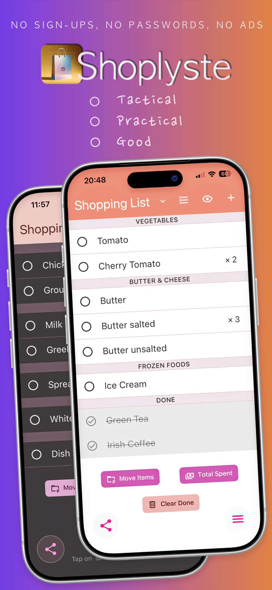
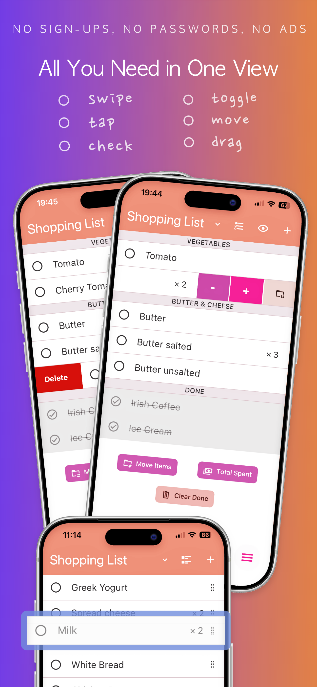
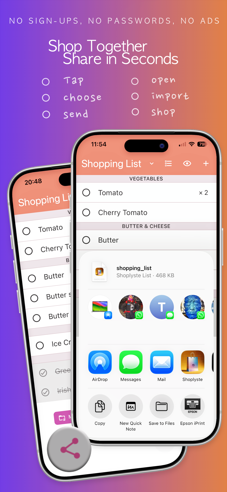
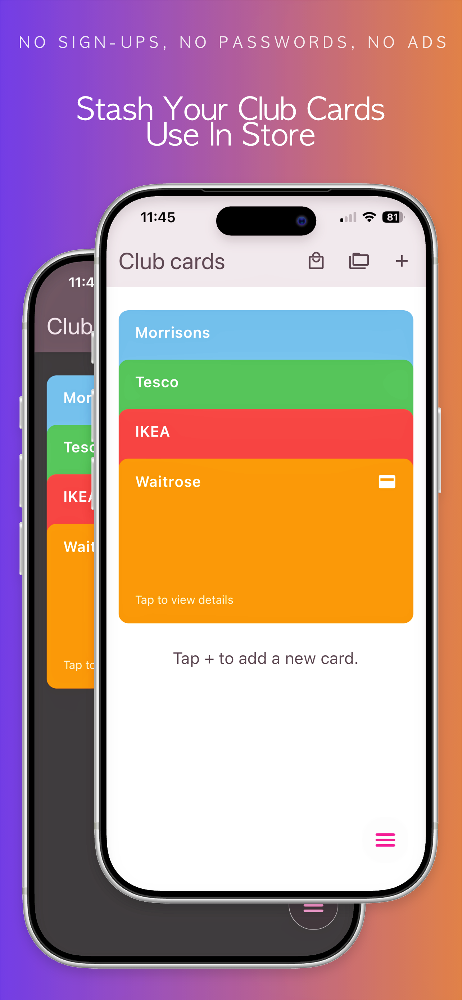
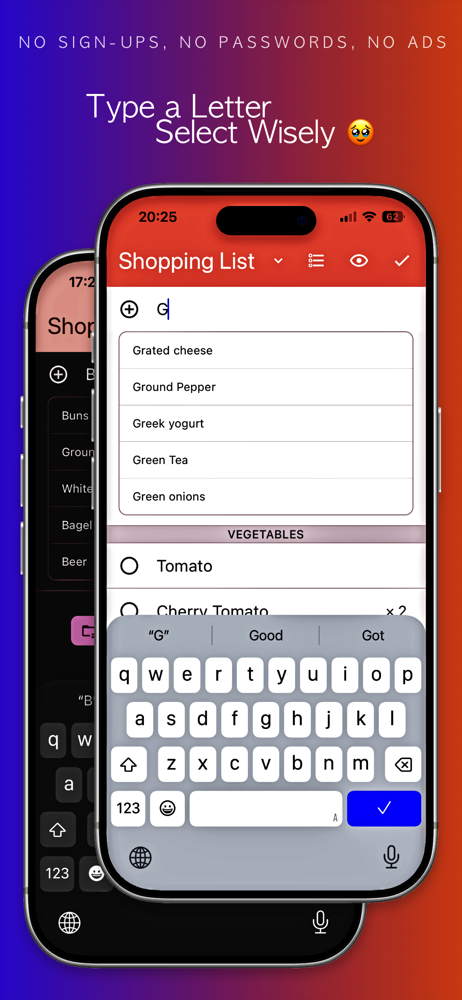
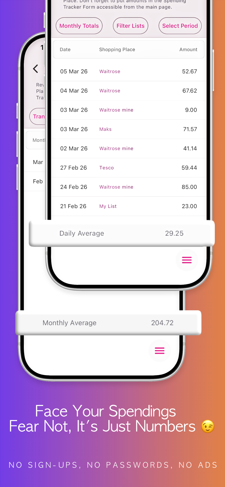
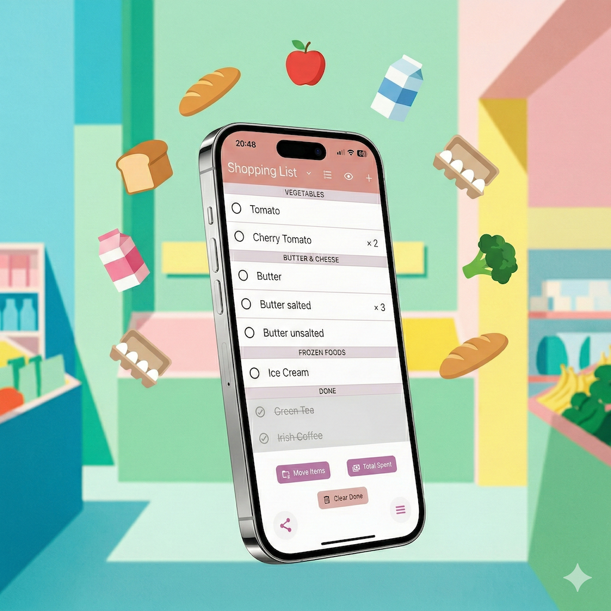

# Shoplyste (iOS and Android)

  
  
  
  
  
  

## References

- [Product and interface overview](https://team5.dev/shoplyste/)
- [List interactions](https://team5.dev/shoplyste/list_contents/)
- [Lists and categories](https://team5.dev/shoplyste/lists&categories/)
- [Sharing workflow](https://team5.dev/shoplyste/share_list/)
- Published applications: [App Store](https://apps.apple.com/us/app/shoplyste-grocery-planner/id6754946133) and [Google Play](https://play.google.com/store/apps/details?id=es.team5.shopkitten)

**Mobile product development and engineering case study**

Shoplyste is an iOS and Android shopping-list application. This document focuses on the product decisions and implementation challenges behind it, particularly interaction design, event coordination, and shared-data reconciliation.

The application source remains private. This repository documents the work; it is not a runnable application.

## 1. Product development

The central product decision was to keep the open shopping list as the primary workspace. Adding and editing items, changing quantities, assigning categories, checking off purchases, reordering, and sharing are accessible from that screen or its contextual controls. The design target for frequent actions was one or two taps, or a swipe, rather than navigation through separate management screens. List selection, moving items, and recording spending are also available from the list context.

Local-first operation is part of this concept: everyday list management requires neither an account nor a network connection. Sharing uses explicit file exchange through existing messaging services, rather than a cloud account or continuous synchronization. This creates a product requirement as well as a technical one: receiving an update should reconcile it with the existing list without indiscriminately replacing local work.

  

## 2. Technologies and engineering

### Main stack

| Area | Technologies and libraries |
| --- | --- |
| Application | TypeScript, React 19, React Native 0.83, Expo SDK 55 |
| Navigation | Expo Router |
| Gestures and animation | React Native Gesture Handler, Reanimated, react-native-draggable-flatlist, react-native-swipeable-item |
| Keyboard and layout | react-native-keyboard-controller, react-native-safe-area-context |
| Data and state | Expo SQLite, Drizzle ORM and migrations, Zustand, React Context, AsyncStorage |
| Interface | React Native Paper / Material Design 3, light and dark themes |
| Localization | i18next, react-i18next, Expo Localization; seven languages and localized starter data |
| Native integrations | Expo FileSystem, Sharing, Linking, Crypto; image picking and cropping |
| Purchases | expo-iap, Apple StoreKit and Google Play Billing; annual and lifetime purchase flows |

### Coordinating gestures within a single list

**Challenge.** The same screen combines vertical scrolling, long-press dragging, horizontal swipes in both directions, checkbox taps, and inline text editing. These cannot be treated as independent components: a drag can begin with a swipe panel open, a tap may be intended to dismiss that panel rather than edit a row, and the keyboard changes the available viewport.

**Implementation.** Manual ordering uses a nestable draggable list inside an outer scroll container; the inner list does not scroll independently. A dedicated long-press handle initiates dragging, with activation thresholds for drag and swipe recognition. The screen tracks the open swipe row and closes other rows as a new one opens. Drag start closes exposed actions, and the actively dragged row renders without the swipe wrapper. Editing likewise replaces the swipeable row with an input rather than stacking both interaction surfaces.

Category grouping uses a separate, keyboard-aware rendering path, while retaining the same row actions. Manual dragging belongs to the ordered-list view, not the grouped view.

**Integration detail.** The swipe library's action underlays are absolutely positioned, but its overlay context does not establish a native layout boundary. Without an explicit native wrapper around each swipeable item, underlays can expand into the surrounding category section. A row-level `View` supplies that boundary. This is a case where composing libraries required understanding their layout behavior, not just connecting their callbacks.

### Inline editing: coordinating focus, submission, and persistence

**Challenge.** An edit may finish through the keyboard submit action, input blur, the toolbar, a background tap, or the start of another interaction. Selecting a product suggestion also changes focus while submitting a value. The implementation has to distinguish completing the current operation from starting the next one.

**Implementation.**

- Submission handlers are shared across entry points. A mutable in-flight guard prevents overlapping new-item submissions, while normalized-name checks reject duplicates among unfinished items.
- The current editing row and text are mirrored in refs so interaction callbacks can inspect the latest editing context. Starting another edit first resolves the previous operation; if a swipe panel is open, the tap closes it and returns instead.
- In category view, a short-lived "was adding" guard suppresses an unintended transition into row editing immediately after the add input disappears.
- Product suggestions are debounced and limited to five results. Selecting one passes its name directly into submission rather than relying on the preceding state update to have rendered.
- Local item collections are updated before persistence completes. New rows receive temporary IDs, which are replaced with database IDs after insertion; a failed insertion removes the temporary row.

These measures address event ordering and perceived responsiveness. They also expose an important distinction: optimistic rendering is not persistence, and the temporary-to-persisted identity transition is part of the interaction design.

### Sharing: explicit conflict rules instead of snapshot replacement

**Challenge.** Two people can independently change a list between exports. An incoming file may be repeated or older than an already adopted update. Even a valid new snapshot can omit something the recipient added locally or contain an unchecked version of an item already purchased.

**Implementation.** Each shared list has a session UUID. Import analysis tracks revisions and export timestamps separately for each sender, together with the last imported file's SHA-256 hash. It blocks self-imports, the last imported identical file, lower revisions, and equal revisions with non-newer timestamps. An accepted file either creates a list or merges into the existing session.

For an existing list, reconciliation uses the following rules:

| Situation | Resolution |
| --- | --- |
| Matching item names | Match after lowercasing and removing whitespace |
| Either copy marks an item completed | Keep it completed: `localDone OR incomingDone` |
| Matching item is locally owned | Preserve its name and quantity; completion may still advance |
| Matching item is not locally owned | Accept the incoming name and quantity |
| Incoming item has no local match | Append it to the list |
| Local item is absent from the snapshot | Delete only if it is unfinished and not locally owned |

Renaming an item or changing its quantity locally marks it as locally owned. List updates and the sender's adopted revision record are committed in the same SQLite transaction.

**Trade-offs.** This is a domain-specific merge policy, not a CRDT or a guarantee of convergence between devices. Completion wins during import, so an unchecked snapshot cannot reopen a completed item. Name-based matching avoids requiring shared item IDs but cannot distinguish identically normalized names or infer renames. Ownership protection favors preserving local work; it is not field-level edit history or per-author ownership. These constraints make the behavior explainable without presenting file exchange as real-time collaboration.

## References

- [Product and interface overview](https://team5.dev/shoplyste/)
- [List interactions](https://team5.dev/shoplyste/list_contents/)
- [Lists and categories](https://team5.dev/shoplyste/lists&categories/)
- [Sharing workflow](https://team5.dev/shoplyste/share_list/)
- Published applications: [App Store](https://apps.apple.com/us/app/shoplyste-grocery-planner/id6754946133) and [Google Play](https://play.google.com/store/apps/details?id=es.team5.shopkitten)

*Visual: Shoplyste onboarding artwork, generated with Google AI Studio (Nanobanana), incorporating the application interface.*
